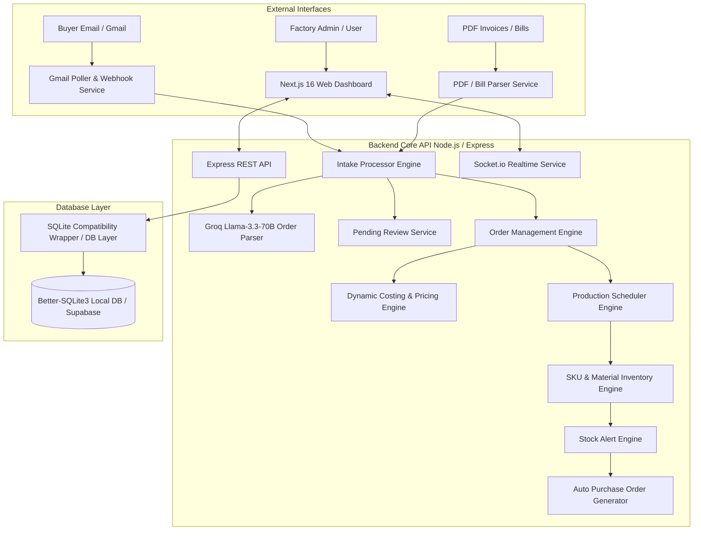

# MSME Garment Factory Management Platform: Architecture & System Guide

## 1. System Overview & Core Purpose
The **MSME Garment Factory Platform** is an end-to-end, AI-powered enterprise resource planning (ERP) and workflow automation platform specifically tailored for small and medium garment manufacturers (MSMEs). 

It bridges the gap between unstructured buyer communications (emails, messages, PDF purchase orders) and factory floor execution by automating:
1. **Unstructured Order Intake & AI Parsing** (Groq Llama 3.3 70B & Gemini AI).
2. **Dynamic Costing & Pricing Calculations** with custom Bill of Materials (BOM) & margin floor protection.
3. **Capacity-Aware Production Scheduling** with working-day logic and stage-by-stage stage progression (Cutting, Stitching, Finishing, Quality Check, Packing).
4. **Automated Inventory Reservation & Auto-Purchase Order (PO) Procurement** when stock breaches safety thresholds.
5. **Real-time Multi-tenant Dashboard & WebSocket Live Updates**.

---

## 2. Platform System Architecture



---

## 3. End-to-End Order Lifecycle & Detailed Workflow

### Phase 1: Automated Order Ingestion & AI Parsing
1. **Multi-Channel Arrival**: Orders enter via automated Gmail background polling (`gmailPoller.js`), webhook intake, or manual dashboard entry.
2. **AI Order Extraction (`orderParser.js`)**:
   - Uses **Groq Llama 3.3 70B** (`llama-3.3-70b-versatile`) with prompt engineering tailored for textile manufacturing terms.
   - Extracts structured details: `buyer_name`, `delivery_deadline`, `garment_type`, `fabric_type`, `colour`, `quantity`, and size splits (`size_breakdown` e.g., `S:100, M:200, L:150`).
3. **Missing Fields & Human-in-the-Loop Review (`pendingReview.js`)**:
   - If required details (e.g. fabric type or size breakdown) are missing or confidence is low, the platform places the entry into `pending_review`.
   - Sends an automated email reply to the buyer requesting specific clarification (`followUpNotifier.js`).
   - When the buyer replies, `intakeProcessor.js` performs a **deep merge** on the thread context, automatically promoting the entry to a confirmed order once complete.

---

### Phase 2: Dynamic Cost Breakdown & Pricing Engine
Once an order is confirmed, the **Pricing Engine** (`pricingEngine.js`) calculates the total manufacturing cost and quotation price per item:

$$\text{Material Cost} = \sum (\text{BOM Unit Qty} \times \text{Item Qty} \times \text{Material Unit Cost})$$

$$\text{Wastage Cost} = \text{Material Cost} \times \text{Wastage \%}$$

$$\text{Labour Cost} = \text{Garment Minutes} \times \text{Labour Rate per Min} \times \text{Quantity}$$

$$\text{Overhead Cost} = \text{Overhead per Unit} \times \text{Quantity}$$

$$\text{Subtotal} = \text{Material} + \text{Wastage} + \text{Labour} + \text{Overhead}$$

$$\text{Total Price} = \text{Subtotal} \times (1 + \max(\text{Requested Margin}, \text{Minimum Margin Floor}))$$

- **Margin Floor Protection**: Protects factory profitability by forcing a hard floor (e.g. minimum 5% margin) even if custom discounts are requested.
- **Garment-Specific Overrides**: Each garment type (e.g. Formal Shirt vs Denim Jeans) can have custom labour minutes, overhead rates, and wastage allowances defined in `garment_pricing_config`.

---

### Phase 3: Capacity-Aware Production Scheduling
The **Production Scheduler** (`productionScheduler.js`) translates total garment quantities into factory floor execution plans:

1. **Labor & Stage Breakdown**:
   - Calculates required minutes for 5 sequential stages: `cutting`, `stitching`, `finishing`, `quality_check`, and `packing`.
   - Uses garment-specific stitching complexity parameters (e.g., Denim Jeans: 30 mins vs T-Shirt: 10 mins).
2. **Working-Day Logic**:
   - Computes completion dates assuming an 8-hour shift across active workers (e.g. 20 workers = 9,600 daily capacity minutes).
   - Skips non-working days (Sundays).
3. **Deadline Feasibility & Risk Alerting**:
   - Compares calculated completion dates against buyer-requested `delivery_deadline`.
   - Flags `deadline_at_risk` and dispatches immediate owner alerts (`notifier.js`) if capacity is constrained.

---

### Phase 4: Inventory Reservation & Auto-PO Procurement
1. **Material Reservation (`inventoryEngine.js`)**:
   - Maps garment orders against the Bill of Materials (BOM) considering size multipliers (e.g., XXL requires more fabric than S).
   - Deducts available inventory when production transitions from `queued` to `cutting`.
2. **Stock Breach Detection (`stockAlerts.js`)**:
   - Checks if remaining stock drops below material reorder levels (`reorder_level`).
3. **Auto Purchase Order (PO) Generation (`autoPO.js`)**:
   - Automatically drafts purchase orders for suppliers with exact replenishment quantities required to restore safety stock.

---

### Phase 5: Real-Time Floor Tracking & Dashboard Monitoring
1. **Stage Progression (`advanceStage`)**:
   - Factory operators advance orders along the pipeline: `queued` $\rightarrow$ `cutting` $\rightarrow$ `stitching` $\rightarrow$ `finishing` $\rightarrow$ `quality_check` $\rightarrow$ `packing` $\rightarrow$ `done (shipped)`.
2. **WebSocket Integration (`socket.js`)**:
   - Emits real-time Socket.io events (`join_order`, stage updates, stock alerts) to all connected dashboard clients without needing manual browser refreshes.

---

## 4. Technology Stack Summary

| Layer | Technology Used | Key Responsibility |
| :--- | :--- | :--- |
| **Frontend UI** | Next.js 16 (App Router), React 19, Tailwind CSS v4, Lucide Icons | Responsive multi-page admin portal & floor tracking UI |
| **Charts & Toast** | Recharts, Sonner | Visual analytics (order velocity, stock levels) & alerts |
| **Realtime Protocol** | Socket.io / Socket.io-Client | Instant UI sync across floor terminals & owner devices |
| **Backend API** | Node.js, Express.js | Core REST endpoints & business logic engines |
| **AI / LLM Ingestion** | Groq SDK (`llama-3.3-70b-versatile`), Google Generative AI | Unstructured email/text parsing into JSON |
| **Email Service** | GoogleAPIs (Gmail API), Nodemailer | Polling buyer threads & sending automated notifications |
| **Database Engine** | `better-sqlite3` with custom SQL compatibility layer | Embedded zero-config storage with Postgres compatibility & Supabase SQL support |

---

## 5. Database & Dialect Compatibility Architecture

To run smoothly in low-resource MSME environments without requiring complex database installation, the backend uses **`better-sqlite3`** backed by an in-memory SQL dialect normalizer (`src/db/index.js`):

- **Query Normalization (`normalizeSqlForSQLite`)**:
  - Translates PostgreSQL-specific types (`::uuid`, `::jsonb`, `gen_random_uuid()`, `ILIKE`, `NOW()`) directly into SQLite-compatible standard functions at runtime.
  - Automatically manages parameter binding serializations (`$1`, `$2` $\rightarrow$ `$p1`, `$p2`).
- **Supabase / PostgreSQL Ready**:
  - Migration script `supabase_migrations_needed.sql` enables seamless upgrading to cloud PostgreSQL / Supabase when scaling up multi-factory deployments.

---

## 6. Key Directory Structure Overview

```
MSME/
├── garment-factory-api/             # Backend Express Server & Engines
│   ├── src/
│   │   ├── db/                     # DB connection & SQLite compatibility wrapper
│   │   ├── middleware/             # Owner authentication & error handling
│   │   ├── routes/                 # REST API routes (orders, materials, bom, pricing, POs)
│   │   ├── services/               # Core domain engines:
│   │   │   ├── orderParser.js      # Groq AI order extraction
│   │   │   ├── intakeProcessor.js  # Email ingestion & message merge
│   │   │   ├── pricingEngine.js    # Costing, wastage, labour & margin floor
│   │   │   ├── productionScheduler.js # Working days & stage progress
│   │   │   ├── inventoryEngine.js  # SKU stock reservation & deduction
│   │   │   ├── autoPO.js           # Low stock auto purchase order creation
│   │   │   └── gmailPoller.js      # Background email monitor
│   │   ├── index.js                # Server entrypoint (HTTP + Socket.io)
│   │   └── socket.js               # Socket.io emitter helper
│   └── package.json
│
└── garment-factory-dashboard/       # Frontend Next.js 16 Portal
    ├── src/
    │   ├── app/                    # App Router pages (orders, inventory, production, etc.)
    │   ├── components/             # Reusable UI components & dashboard widgets
    │   └── lib/                    # API client instance & utility functions
    └── package.json
```
